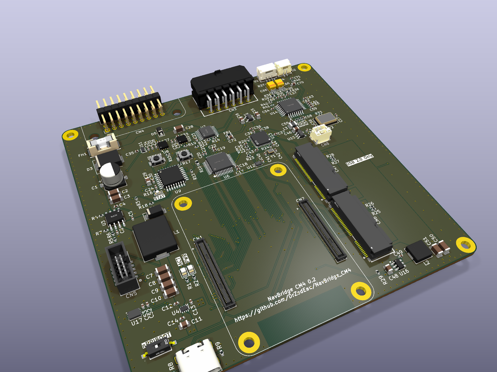
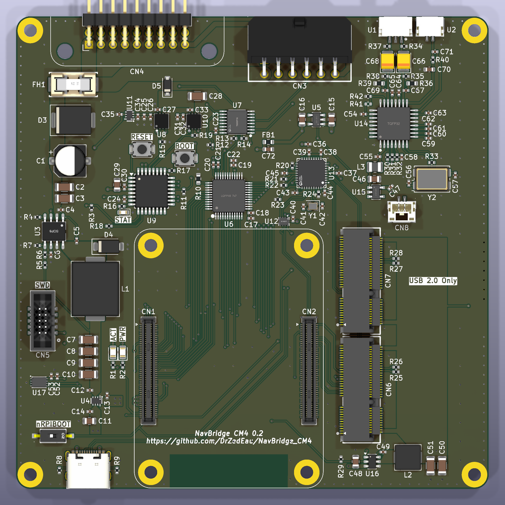
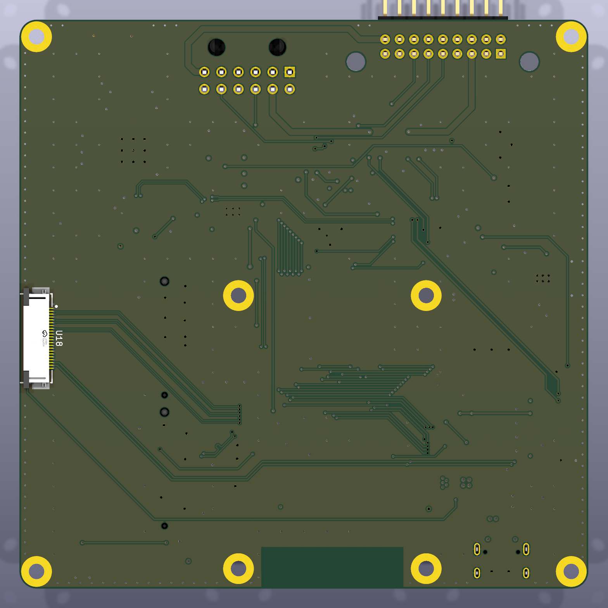

# NavBridge CM4

A Raspberry Pi Compute Module 4 carrier board for BMW E-Series vehicles equipped with the OEM navigation system (E46, E39, E85, and similar platforms).

The NavBridge CM4 installs inline between the factory wiring harness and the BMW MK3/MK4 navigation module, allowing a Raspberry Pi Compute Module to integrate with the original infotainment system while preserving the OEM look and functionalities.

Its primary purpose is to provide modern features such as Android Auto and Apple CarPlay through the Raspberry Pi while continuing to use the factory display, controls, and audio system.

This revision is designed for the **Raspberry Pi CM4** and should also work with the **CM5**, which uses the same connectors (see [Using a CM5](#using-a-cm5)).

<p align="center">
  
</p>

---

## Overview

The board interfaces directly with the factory navigation module and provides:

- Video output from the Raspberry Pi to the OEM BMW display (analog RGB with sync on green)
- Switching of the display between the factory navigation picture and the Raspberry Pi
- Stereo audio output for integration with the factory AUX input or CDC interface
- Microphone input
- Integration with the BMW I-Bus for power management and button control
- Two M.2 Key E expansion slots
- A CSI camera connector
- An Apple MFi authentication coprocessor

The hardware is designed to run [NavBridge App](https://github.com/DrZedEau/NavBridge_App), a standalone Android Auto head unit for the Raspberry Pi, or the [LIVI](https://github.com/f-io/LIVI) project.

---

## Features

### Hardware

- 100 × 100 mm, 4-layer PCB
- Raspberry Pi CM4 / CM5 connectors (2 × 100-pin Hirose DF40C)
- Automotive-grade 5 V / 3.5 A buck converter (**LMR14030-Q1**), switched on and off by the MCU
- Fused battery input with a **SMCJ24A** TVS diode
- USB-C port for Raspberry Pi flashing (rpiboot) and bench power, with automatic selection between USB-C and the car supply (**TPS2117**)
- 4-port USB 2.0 hub (**USB2514B**) for the MCU, the audio codec and both M.2 slots
- 24-bit video DAC (**ADV7125**) fed by the Raspberry Pi DPI output
- Analog RGB switch (**TMUX1574**) to select the factory navigation picture or the Raspberry Pi picture
- Integrated **PCM2912A** USB audio codec
  - Stereo line output
  - Mono microphone input with bias
- Two M.2 Key E slots, powered by a dedicated 3.3 V / 2 A buck converter (**AP63203**)
  - CN6: PCIe x1 + USB 2.0
  - CN7: USB 2.0 only
- 22-pin CSI camera connector (CAM1, 2 lanes) on the bottom side
- Apple **MFi343S00177** authentication coprocessor on I²C
- Auxiliary 5 V output connector
- SWD connector for the STM32

The board has no SD card slot, so it needs a Compute Module with eMMC (not a Lite module).

### Vehicle Integration

- Two **ATA663231** LIN transceivers: one on the car I-Bus, one on the navigation module's I-Bus, with the MCU in between
- **STM32C071** microcontroller for:
  - Raspberry Pi power management
  - OEM button translation
  - Composite sync (CSYNC) generation for the OEM display
  - Video source selection
- The MCU is powered from the car battery through the car-side LIN transceiver's built-in 3.3 V regulator, so it keeps watching the I-Bus while the Raspberry Pi is off
- No modifications to the factory wiring or infotainment system are required

---

## Board Overview

<p align="center">
  
</p>

<p align="center">
  
</p>

### Connectors

| Ref | Connector | Use |
|---|---|---|
| CN1, CN2 | Hirose DF40C-100DS | Raspberry Pi CM4 / CM5 |
| CN3 | Molex Micro-Fit 3.0, 12 pins (43045-1200) | To the navigation module |
| CN4 | 2 × 9 pin header, 2.54 mm, right angle | Car harness (X1313 connector) |
| CN5 | 2 × 5 pin header, 1.27 mm | STM32 SWD |
| CN6 | M.2 Key E | PCIe x1 + USB 2.0 module |
| CN7 | M.2 Key E | USB 2.0 module |
| CN8 | JST GH, 2 pins | Auxiliary +5 V output |
| U1 | JST GH, 3 pins | Stereo line output |
| U2 | JST GH, 2 pins | Microphone input |
| U18 | 22-pin FPC, 0.5 mm (bottom side) | CSI camera (CAM1) |
| J1 | USB-C | Raspberry Pi flashing and bench power |

#### CN4 – Car harness

| Pin | Signal | Pin | Signal |
|---|---|---|---|
| 1 | +BATT | 2 | GND |
| 3 | – | 4 | – |
| 5 | I-Bus | 6 | GND |
| 7 | – | 8 | – |
| 9 | Green out | 10 | GND |
| 11 | Blue out | 12 | GND |
| 13 | Red out | 14 | GND |
| 15 | – | 16 | – |
| 17 | Nav audio + | 18 | Nav audio − |

#### CN3 – Navigation module

| Pin | Signal | Pin | Signal |
|---|---|---|---|
| 1 | GND | 7 | +BATT |
| 2 | GND | 8 | I-Bus (navigation side) |
| 3 | GND | 9 | Red in |
| 4 | GND | 10 | Green in |
| 5 | GND | 11 | Blue in |
| 6 | Nav audio − | 12 | Nav audio + |

+BATT and the navigation audio pass straight through between CN3 and CN4. The I-Bus does not: the car I-Bus (CN4 pin 5) and the navigation module's I-Bus (CN3 pin 8) each have their own ATA663231 transceiver, and the STM32 passes messages between them. The red, green and blue signals from the navigation module go through the RGB switch before reaching the display.

#### Audio connectors

| Connector | Pin 1 | Pin 2 | Pin 3 |
|---|---|---|---|
| U2 (microphone) | MIC in | GND | |
| U1 (line out) | Left | GND | Right |
| CN8 (aux power) | +5 V | GND | |

### Buttons and LEDs

| Silkscreen | Part | Function |
|---|---|---|
| nRPIBOOT | SW1 (slide switch) | Pulls the CM `nRPIBOOT` low and routes the CM USB port to the USB-C connector, for flashing with rpiboot |
| RESET | SW2 | STM32 reset |
| BOOT | SW3 | STM32 BOOT0, to start the USB DFU bootloader |
| PWR | D2 (red) | CM power LED |
| ACT | D1 (green) | CM activity LED |
| STAT | D6 (yellow) | STM32 status LED |

### Power

```text
+BATT ─┬─ fuse ─ TVS ─ LMR14030 5 V buck (enabled by MCU) ─┐
       │                                                   ├─ TPS2117 ─ +5 V ─ CM and peripherals
       │                                 USB-C 5 V ────────┘
       │
       └─ diode ─ ATA663231 (car I-Bus) ─ 3.3 V ─┐
                                                 ├─ TPS2117 ─ 3.3 V ─ STM32, RGB switch
                          CM 3.3 V output ───────┘

+5 V ─ TLV75533 LDO ─ 3.3 V ─ USB hub, USB switch, video DAC (through a ferrite bead)
+5 V ─ AP63203 buck ─ 3.3 V ─ M.2 slots, camera
+5 V ─ TPS2051B switch ─ PCM2912A audio codec
```

The battery fuse holder (FH1) takes a Littelfuse 0451003.MRL (3 A) fuse, fitted by hand after assembly.

The TPS2117 selects between the car supply and USB-C automatically, so the board can be powered on the bench from USB-C alone.

### Video

The Raspberry Pi drives the **ADV7125** video DAC through its 24-bit DPI interface. The STM32 combines the DPI `HSYNC` and `VSYNC` into a composite sync (`CSYNC`) with a hardware timer and feeds it to the DAC, which adds it to the green channel (RGsB) as the BMW display expects.

The **TMUX1574** switch, controlled by the STM32, selects which picture reaches the display: the Raspberry Pi or the factory navigation module.

### USB

The CM USB 2.0 port goes through a **TS3USB221** switch controlled by the nRPIBOOT switch:

- **nRPIBOOT off** (normal use): CM → **USB2514B** hub → STM32, PCM2912A codec, M.2 slot CN6, M.2 slot CN7
- **nRPIBOOT on**: CM → USB-C connector, to flash the eMMC with rpiboot

---

## Using a CM5

The CM5 uses the same connectors as the CM4 and keeps the CM4 pinout for the interfaces this board uses (DPI, USB 2.0, PCIe, CSI camera, I²C, `nRPIBOOT`, LEDs), so it should work on this board. It has not been tested yet. A few points to keep in mind:

- The CM5's USB 3.0 ports are not used.
- CSYNC is generated by the STM32, so the board does not rely on the CM5's RP1 PIO as the [CM5 NavBridge](https://github.com/DrZedEau/CM5_NavBridge) did.
- The 5 V rail comes from a 3.5 A buck converter. A CM5 under heavy load, together with power-hungry M.2 or USB devices, can get close to that limit.
- The CM5 runs hotter than the CM4; leave room for a heatsink in the case.

---

## Repository Structure

```text
hardware/      KiCad project (revision 0.2) and the revision 0.1 archive
firmware/      STM32C071 MCU firmware
scripts/       Raspberry Pi setup script
3D/            STL files for printed parts (case and connector)
images/        Pictures and renders
```

The KiCad project in [hardware/](hardware/) was made with KiCad 10 and includes its symbol, footprint and 3D model libraries.

---

## Project Status

Revision 0.2 is the current revision of the CM4 board. Revision 0.1 is kept as an archive in [hardware/](hardware/).

- [x] Schematic and PCB layout
- [ ] Prototype testing
- [ ] STM32 firmware (the CSYNC generator has been validated on a NUCLEO-C071RB)
- [ ] Raspberry Pi setup script
- [ ] 3D printed case and connector

---

## Roadmap

- Test the first prototypes in the car
- Test with a CM5
- Expand compatibility testing across additional BMW platforms

---

## Contributing

Contributions are welcome.

Bug reports, hardware improvements, firmware enhancements, and documentation updates are all appreciated. Please open an issue or submit a pull request if you would like to contribute.

---

## License

Copyright 2026 DrZedEau

The hardware design — the KiCad project in `hardware/`, the 3D printed parts in `3D/` and the images in `images/` — is licensed under the **CERN Open Hardware Licence Version 2 – Strongly Reciprocal** (CERN-OHL-S-2.0), see [LICENSE](LICENSE). You may redistribute and modify it and make products from it under the terms of that licence. It is distributed without any express or implied warranty, including of merchantability, satisfactory quality and fitness for a particular purpose.

Source location: https://github.com/DrZedEau/NavBridge_CM4

As required by section 4 of the CERN-OHL-S, products made from this design must, where practicable, keep this source location visible.

The firmware in `firmware/` and the Raspberry Pi setup script in `scripts/` are licensed under the **GNU General Public License v2.0** (GPL-2.0), see [firmware/LICENSE](firmware/LICENSE) and [scripts/LICENSE](scripts/LICENSE). Third-party files keep their own licences.

---

## References

- CM5 NavBridge (previous board) https://github.com/DrZedEau/CM5_NavBridge
- NavBridge App https://github.com/DrZedEau/NavBridge_App
- LIVI project https://github.com/f-io/LIVI
- Raspberry Pi CM4 datasheet https://datasheets.raspberrypi.com/cm4/cm4-datasheet.pdf
- BMW Wiring Diagram System (WDS) https://bmwteka.com/wds/en/e85/e82460cf
- BMW On-Board Monitor documentation https://bmwteka.com/wds/en/e85/1b7f9876
- Community resources https://www.e46fanatics.com/threads/bmw-on-board-monitor-without-navigation-unit.1303552
