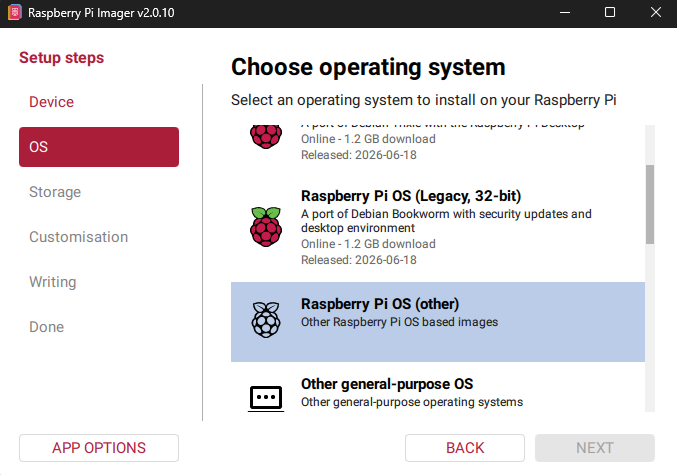
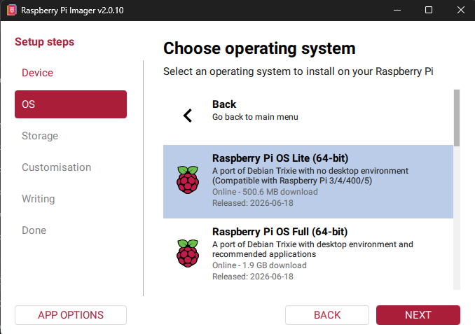
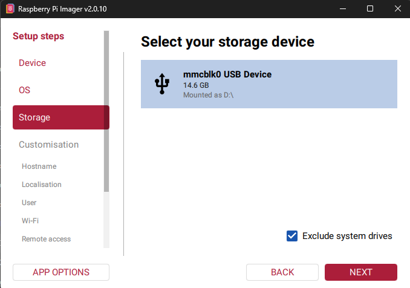
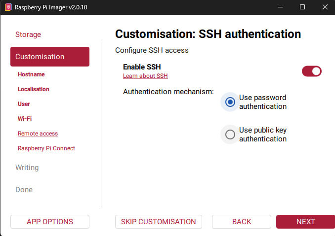

# Flash the Compute Module

This writes Raspberry Pi OS to the Compute Module's eMMC over USB, and on a CM4 also changes a bootloader setting the board needs.

You need:

- A CM4 or CM5 with eMMC and wireless (see [Compute Module](README.md#compute-module)), fitted on CN1 and CN2 and held by the four M2.5 holes around them. A CM5 also needs a heatsink.
- A computer with a USB port and a USB-C data cable. The CM4 bootloader step below is written for Linux (a PC or another Raspberry Pi).
- A 5 V / 3 A USB-C charger for the first boot

Raspberry Pi's own guide: [Flash an image to a Compute Module](https://www.raspberrypi.com/documentation/computers/compute-module.html#flash-compute-module-emmc).

## 1. Install rpiboot

On Linux, build it from Raspberry Pi's [usbboot](https://github.com/raspberrypi/usbboot) repository:

```bash
sudo apt install git libusb-1.0-0-dev pkg-config build-essential
git clone --recurse-submodules --shallow-submodules --depth=1 https://github.com/raspberrypi/usbboot
cd usbboot
make
```

On Windows, run the installer from the [usbboot releases](https://github.com/raspberrypi/usbboot/releases). It installs the drivers and rpiboot, with a "Mass Storage Gadget" entry in the Start menu.

## 2. Put the Compute Module in USB boot mode

1. Set the **nRPIBOOT** switch (SW1) to ON. It pulls the CM's `nRPIBOOT` low and connects the CM's USB port to J1.
2. Connect J1 to the computer. The board is powered from the computer's USB port.

## 3. CM4 only: set the bootloader to turn the 3.3 V rail off at shutdown

The CM4 keeps its 3.3 V rail up after `shutdown` unless its bootloader EEPROM says otherwise, and the MCU waits for that rail to go away before it turns the 5 V buck off: without this setting, the board keeps drawing from the car battery after shutdown. Compute Modules ship with the `rpi-eeprom-update` service disabled, so the EEPROM is written over USB with usbboot's `recovery` files.

In the `usbboot` folder, edit `recovery/boot.conf`:

```bash
cd recovery
nano boot.conf
```

It already has both settings. Change them to:

```text
WAKE_ON_GPIO=0
POWER_OFF_ON_HALT=1
```

Leave the other lines as they are. Then build the EEPROM image and send it to the CM4:

```bash
./update-pieeprom.sh
sudo ../rpiboot -d .
```

This also installs the latest stable CM4 bootloader, which usbboot ships in that folder. Give it a few seconds after rpiboot has finished, then unplug J1 and plug it back in, with SW1 still ON, for the next step. You check the result after the first boot.

A CM5 does not need this: it already turns its 3.3 V rail off at shutdown (`POWER_OFF_ON_HALT=1` is its default).

## 4. Write the eMMC

Make the eMMC show up as a USB drive. On Linux, from the `usbboot` folder:

```bash
sudo ./rpiboot -d mass-storage-gadget
```

On Windows, start the Mass Storage Gadget from the Start menu.

Then open [Raspberry Pi Imager](https://www.raspberrypi.com/software/):

1. **Device:** your Compute Module (CM4 or CM5).
2. **OS:** Raspberry Pi OS (other), then **Raspberry Pi OS Lite (64-bit)**. The app runs without a desktop.

   <p align="center">
     
   </p>

   <p align="center">
     
   </p>

3. **Storage:** the Compute Module's eMMC (`mmcblk0 USB Device`).

   <p align="center">
     
   </p>

4. **Customisation:** set a hostname, a user and password (not `root`), your Wi-Fi and its country, and **enable SSH**. The board has no Ethernet, so Wi-Fi and SSH are the way in.

   <p align="center">
     
   </p>

5. Write the image.

## 5. First boot

1. Unplug J1 and set **nRPIBOOT** (SW1) back to OFF.
2. Power the board from a 5 V / 3 A USB-C charger on J1. The first boot takes a while.
3. Connect over SSH: `ssh <user>@<hostname>.local`

On a CM4, check the bootloader setting:

```bash
vcgencmd bootloader_config
```

It must show `POWER_OFF_ON_HALT=1` and `WAKE_ON_GPIO=0`. If not, do step 3 again.

Next: [Set up the Pi and flash the MCU](SETUP.md).
