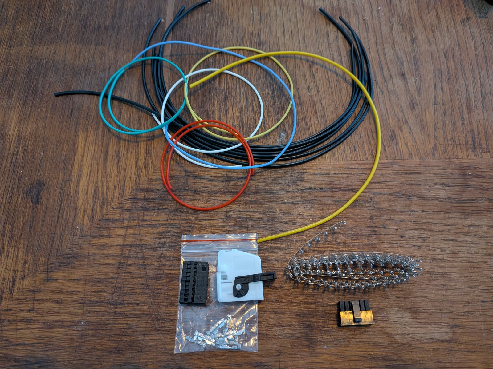
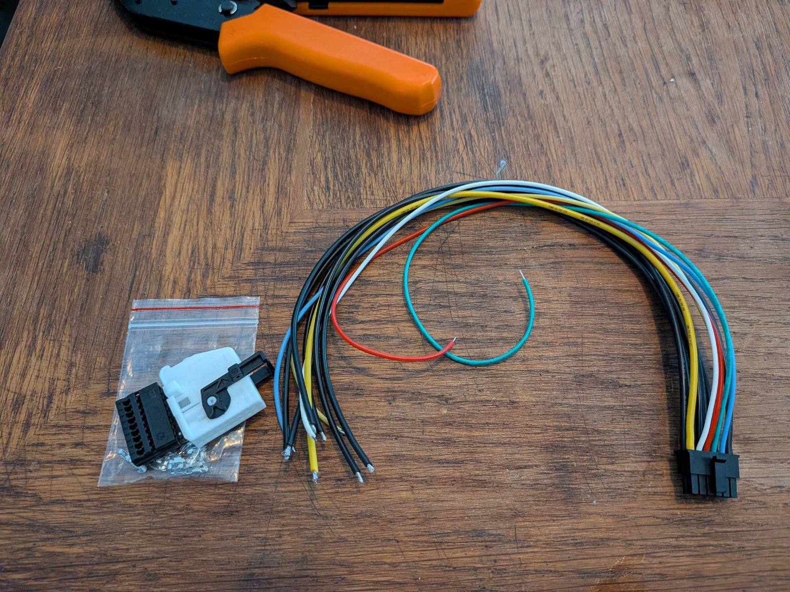
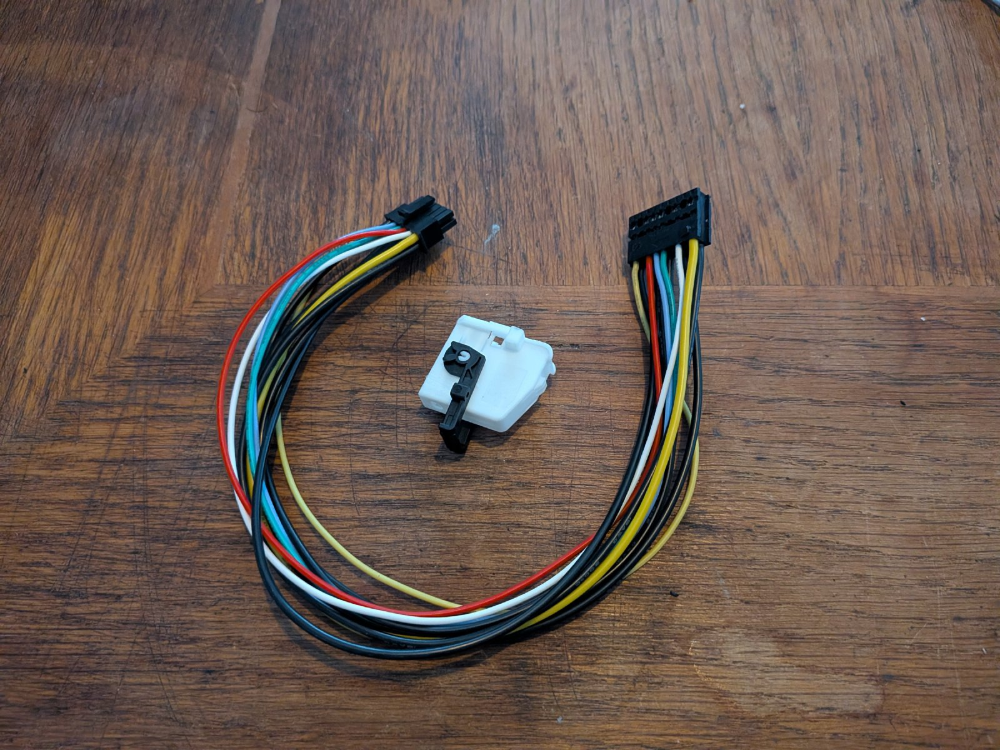
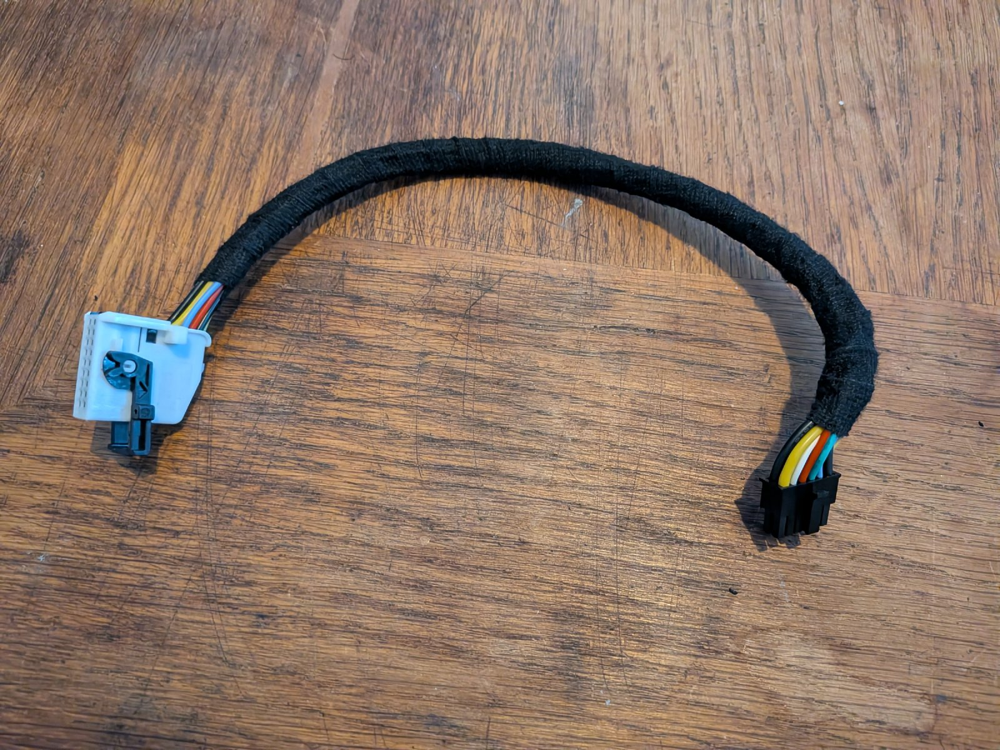
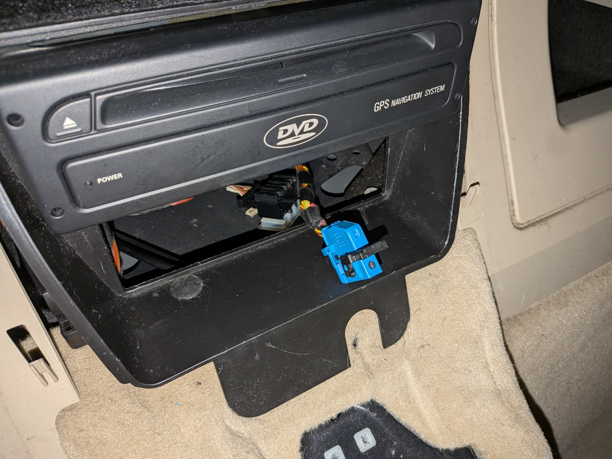
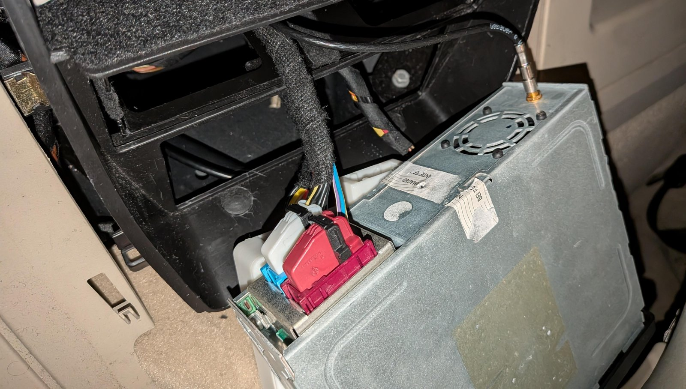

# Navigation Cable and Installation in the Car

The NavBridge CM4 sits between the car's harness and the BMW navigation module:

- **CN4** (2 × 9 pin header, 2.54 mm): takes the car's X1313 plug, the blue 18-pin plug that normally goes into the navigation module. A 3D printed housing around the header holds the plug in place.
- **CN3** (Molex Micro-Fit 3.0, 12 pins): a DIY cable goes from here to the navigation module's X1313 socket.

> [!NOTE]
> The 3D printed housing for CN4 is not published for this board yet, see [3D/README.md](../3D/README.md).

## Make the cable

### Parts

- **Board end:** a Molex Micro-Fit 3.0 receptacle housing, 2 × 6 pins (43025-1200), and 12 female crimp terminals (43030 series, for your wire size)
- **Navigation module end:** an 18-pin plug for the X1313 socket. The OEM blue plug is no longer available, but a white or black 18-pin TE Connectivity 1379100-2 fits once you cut off the extra plastic, so that it sits next to the other plugs on the module. You also need its 12 contacts.
- 12 wires: at least 0.5 mm² (20 AWG) for +BATT and the grounds
- A crimp tool for both terminal types, and harness tape

  

### Wiring

Wire each signal on CN3 to the same signal on the X1313 plug. The grounds are all the same: the five GND wires can go to any of the GND pins.

#### CN3 – Board end (Micro-Fit)

The pin numbers are moulded on the Micro-Fit housing: pins 1 to 6 are on one row, 7 to 12 on the other.

| Pin | Signal | Pin | Signal |
|---|---|---|---|
| 1 | GND | 7 | +BATT |
| 2 | GND | 8 | I-Bus (navigation side) |
| 3 | GND | 9 | Red in |
| 4 | GND | 10 | Green in |
| 5 | GND | 11 | Blue in |
| 6 | Nav audio − | 12 | Nav audio + |

#### X1313 – Navigation module end (18-pin plug)

BMW numbers the X1313 pins 1 to 9 on one row and 10 to 18 on the other.

| Pin | Signal | Pin | Signal |
|---|---|---|---|
| 1 | +BATT | 10 | GND |
| 2 | – | 11 | – |
| 3 | I-Bus | 12 | GND |
| 4 | – | 13 | – |
| 5 | Green out | 14 | GND |
| 6 | Blue out | 15 | GND |
| 7 | Red out | 16 | GND |
| 8 | – | 17 | – |
| 9 | Nav audio + | 18 | Nav audio − |

This is the same pinout as the car's plug on CN4, but the board's header numbers the pins in zigzag: X1313 pins 1 to 9 are CN4 pins 1, 3, 5 … 17, and X1313 pins 10 to 18 are CN4 pins 2, 4, 6 … 18 (see [CN4 – Car harness](../hardware/README.md#cn4--car-harness)).

> [!WARNING]
> A cable made for the [CM5 NavBridge](https://github.com/DrZedEau/CM5_NavBridge) has the navigation audio the other way round on the Micro-Fit (pin 6 +, pin 12 −). Swap those two terminals in the Micro-Fit housing before using it on this board. The car side (CN4) is the same on both boards.

Take your time stripping and crimping:

  

  

Then wrap it with harness tape:

  

## Install in the car

Before going to the car, set up the board on the bench (see the [documentation](README.md)). A blank MCU never turns the Raspberry Pi on in the car.

Requirements:

- The 3 A fuse fitted in FH1 (Littelfuse 0451003.MRL)
- The car battery disconnected

Steps:

1. Unplug the blue X1313 plug from the navigation module:

   

     
   

2. Plug the DIY cable's 18-pin plug into the navigation module, and its Micro-Fit end into CN3:

   

     
   

3. Plug the car's blue X1313 plug into CN4, through the 3D printed housing.
4. Connect the line output (U1) to the car's AUX or CD changer input, and optionally a microphone to U2 (see [Audio connectors](../hardware/README.md#audio-connectors)).
5. Find a spot for the board, and reconnect the battery.

The MCU starts from the car supply and turns the Raspberry Pi on when the ignition comes on.
