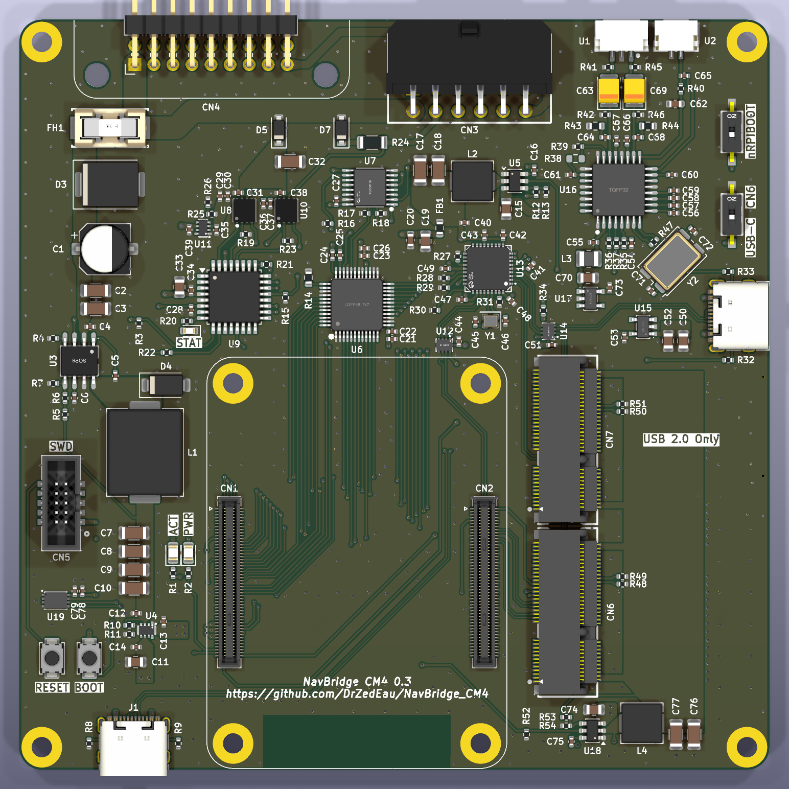
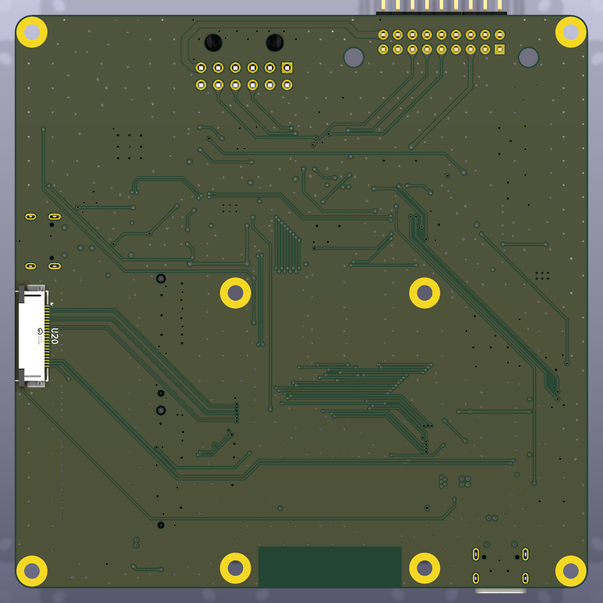

# Hardware

The NavBridge CM4 board in detail: its parts, connectors, power, video and USB, and the KiCad project.

| Path | Content |
|---|---|
| `NavBridge_CM4/` | Revision 0.3 (current): schematics, PCB layout, project-local symbol, footprint and 3D model libraries |
| `NavBridge_CM4/production/` | JLCPCB fabrication files (Gerber archive, BOM, pick-and-place), made with the Fabrication Toolkit plugin |

Earlier revisions (0.1 and 0.2) are in the git history.

The project was made with **KiCad 10**. Open `NavBridge_CM4/NavBridge_CM4.kicad_pro`.

The project-local libraries only include the 3D models used on the board. The other models come from the standard KiCad library (`KICAD10_3DMODEL_DIR`, and `KICAD9_3DMODEL_DIR` for a few footprints).

## Board

- 100 × 100 mm, 4 copper layers, 1.6 mm
- 4 × M2.5 mounting holes at the corners (3 mm from each edge)
- 4 × M2.5 mounting holes for the Compute Module
- GND stitching vias around the board edge and across the ground pours
- Teardrops on vias and through-hole pads
- The battery fuse holder (FH1) takes a Littelfuse 0451003.MRL (3 A) fuse, fitted by hand after assembly
- No SD card slot: the Compute Module must have eMMC

<p align="center">
  
</p>

<p align="center">
  
</p>

## Main parts

| Function | Part |
|---|---|
| Compute Module connectors | 2 × Hirose DF40C-100DS (CN1, CN2), CM4 or CM5 |
| MCU | STM32C071 (U9) |
| I-Bus transceivers | 2 × ATA663231: car side (U8), navigation side (U10) |
| 5 V buck, from the car supply | LMR14030-Q1, 5 V / 3.5 A, automotive grade, switched on and off by the MCU |
| Battery protection | Fuse (FH1) and SMCJ24A TVS diode |
| Power muxes | 2 × TPS2117: 5 V from the buck or USB-C (U4), MCU 3.3 V from the LIN regulator or the CM (U11) |
| 3.3 V bucks | 2 × TPS54202, 2 A: USB hub, USB switches and video DAC (U5); M.2 slots and camera (U18) |
| Power switches | 2 × TPS2051B: audio codec; USB-C host port, 500 mA (U15) |
| USB hub | USB2514B, 4 ports |
| USB switches | 2 × TS3USB221: CM USB to the hub or to J1 (rpiboot); hub port 2 to CN6 or to J2 (U14) |
| Video DAC | ADV7125, 24-bit |
| RGB switch | TMUX1574 |
| Audio codec | PCM2912A: stereo line output, mono microphone input with bias |
| CarPlay authentication | Apple MFi343S00177, on I²C |

## Connectors

| Ref | Connector | Use |
|---|---|---|
| CN1, CN2 | Hirose DF40C-100DS | Raspberry Pi CM4 / CM5 |
| CN3 | Molex Micro-Fit 3.0, 12 pins (43045-1200) | To the navigation module |
| CN4 | 2 × 9 pin header, 2.54 mm, right angle | Car harness (X1313 connector) |
| CN5 | 2 × 5 pin header, 1.27 mm | STM32 SWD |
| CN6 | M.2 Key E | PCIe x1 + USB 2.0 module (the USB is shared with J2) |
| CN7 | M.2 Key E | USB 2.0 module |
| U1 | JST GH, 3 pins | Stereo line output |
| U2 | JST GH, 2 pins | Microphone input |
| U20 | 22-pin FPC, 0.5 mm (bottom side) | CSI camera (CAM1, 2 lanes) |
| J1 | USB-C | Raspberry Pi flashing and bench power |
| J2 | USB-C | USB 2.0 host port, 500 mA |

### CN4 – Car harness

| Pin | Signal | Pin | Signal |
|---|---|---|---|
| 1 | +BATT | 2 | GND |
| 3 | – | 4 | – |
| 5 | I-Bus | 6 | GND |
| 7 | – | 8 | – |
| 9 | Green out | 10 | GND |
| 11 | Blue out | 12 | GND |
| 13 | Red out | 14 | GND |
| 15 | – | 16 | – |
| 17 | Nav audio + | 18 | Nav audio − |

### CN3 – Navigation module

| Pin | Signal | Pin | Signal |
|---|---|---|---|
| 1 | GND | 7 | +BATT |
| 2 | GND | 8 | I-Bus (navigation side) |
| 3 | GND | 9 | Red in |
| 4 | GND | 10 | Green in |
| 5 | GND | 11 | Blue in |
| 6 | Nav audio − | 12 | Nav audio + |

+BATT and the navigation audio pass straight through between CN3 and CN4. The I-Bus does not: the car I-Bus (CN4 pin 5) and the navigation module's I-Bus (CN3 pin 8) each have their own ATA663231 transceiver, and the STM32 passes messages between them. The red, green and blue signals from the navigation module go through the RGB switch before reaching the display. The cable from CN3 to the navigation module is in [Make the navigation cable](../documentation/NAV_CABLE.md).

### Audio connectors

| Connector | Pin 1 | Pin 2 | Pin 3 |
|---|---|---|---|
| U2 (microphone) | MIC in | GND | |
| U1 (line out) | Left | GND | Right |

## Buttons and LEDs

| Silkscreen | Part | Function |
|---|---|---|
| nRPIBOOT | SW1 (slide switch) | Pulls the CM `nRPIBOOT` low and routes the CM USB port to the USB-C connector J1, for flashing with rpiboot |
| CN6 / USB-C | SW4 (slide switch) | Connects hub port 2 to M.2 slot CN6 (ON) or to the USB-C host port J2 (OFF) |
| RESET | SW2 | STM32 reset |
| BOOT | SW3 | STM32 BOOT0, to start the USB DFU bootloader |
| PWR | D2 (red) | CM power LED |
| ACT | D1 (green) | CM activity LED |
| STAT | D6 (yellow) | STM32 status LED |

The MCU can only be reflashed with the board powered from USB-C (J1). The BOOT button and the SWD connector's VTref both take their 3.3 V from the Compute Module.

## Power

```text
+BATT ─┬─ fuse ─ TVS ─ LMR14030 5 V buck (enabled by MCU) ─┐
       │                                                   ├─ TPS2117 ─ +5 V ─ CM and peripherals
       │                            USB-C (J1) 5 V ────────┘
       │
       ├─ diode ─ ATA663231 (car I-Bus) ─ 3.3 V ─┐
       │                                         ├─ TPS2117 ─ 3.3 V ─ STM32, RGB switch
       │                  CM 3.3 V output ───────┘
       │
       └─ diode ─ 1 kΩ ─ navigation I-Bus (LIN master termination)

+5 V ─ TPS54202 buck ─ 3.3 V ─ USB hub, USB switches, video DAC (through a ferrite bead)
+5 V ─ TPS54202 buck ─ 3.3 V ─ M.2 slots, camera
+5 V ─ TPS2051B switch ─ PCM2912A audio codec
+5 V ─ TPS2051B switch (500 mA) ─ USB-C host port (J2)
```

- The two TPS54202 converters and the two TPS2051B switches are enabled by the CM 3.3 V output, so they only run while the Compute Module is on.
- The TPS2117 selects between the car supply and USB-C automatically, so the board can be powered on the bench from USB-C alone. A divider on its `PR1` pin makes it switch to the car supply only once the buck output is above about 4.3 V, not while the buck is still starting up. The MCU's TPS2117 does the same with the LIN regulator, above about 2.5 V.
- The MCU is powered from the car battery through the car-side LIN transceiver's built-in 3.3 V regulator, so it keeps watching the I-Bus while the Raspberry Pi is off. It turns the 5 V buck on with the ignition, and off once the CM 3.3 V rail has gone away (see [firmware/README.md](../firmware/README.md)).
- A CM5 under heavy load, together with power-hungry M.2 or USB devices, can get close to the 3.5 A of the 5 V buck.

## I-Bus

- Two **ATA663231** LIN transceivers: one on the car I-Bus (U8), one on the navigation module's I-Bus (U10), with the STM32 in between. It forwards the frames both ways and sends them to the Pi over USB.
- LIN master termination (1 kΩ + diode, R24 and D7) on the navigation-side I-Bus, since the board is the only master on that segment.
- The car's wiring is not modified: the board plugs in between the car harness and the navigation module.

## Video

The Raspberry Pi drives the **ADV7125** video DAC through its 24-bit DPI interface. The STM32 combines the DPI `HSYNC` and `VSYNC` into a composite sync (`CSYNC`) with a hardware timer and feeds it to the DAC, which adds it to the green channel (RGsB) as the BMW display expects. So the board does not rely on the CM5's RP1 PIO for CSYNC, as the [CM5 NavBridge](https://github.com/DrZedEau/CM5_NavBridge) did.

The **TMUX1574** switch, controlled by the STM32, selects which picture reaches the display: the Raspberry Pi or the factory navigation module.

## USB

The CM USB 2.0 port goes through a **TS3USB221** switch controlled by the nRPIBOOT switch (SW1):

- **nRPIBOOT off** (normal use): CM → **USB2514B** hub:
  - port 1: M.2 slot CN7
  - port 2: M.2 slot CN6 or the USB-C host port (J2), through a second **TS3USB221** set by the CN6 / USB-C switch (SW4)
  - port 3: PCM2912A audio codec
  - port 4: STM32
- **nRPIBOOT on**: CM → USB-C connector (J1), to flash the eMMC with rpiboot

The USB-C host port (J2) supplies up to 500 mA through a **TPS2051B** current-limited switch and advertises default USB power (56 kΩ pull-ups on CC1/CC2). It is powered while the Compute Module is on and is meant for low-power devices, such as an analog video converter. When it is selected, M.2 slot CN6 has no USB, only PCIe.

The CM5's USB 3.0 ports are not used.

## Schematic sheets

| Sheet | Content |
|---|---|
| NavBridge_CM4 | CM4 / CM5 connectors, car connectors, audio connectors, LEDs, nRPIBOOT switch, mounting holes |
| Power | Battery input, LMR14030 5 V buck, USB-C connector (J1), TPS2117 power mux, TPS54202 3.3 V buck for the USB hub, the USB switches and the video DAC |
| MCU_Lin | STM32C071 MCU, two ATA663231 LIN transceivers (car I-Bus and navigation I-Bus), navigation I-Bus master termination, TPS2117 MCU power mux, SWD connector |
| Analog_RGB | ADV7125 video DAC and its supply filter, TMUX1574 RGB switch, 75 Ω termination |
| USB | USB2514B hub, TS3USB221 USB switch for rpiboot |
| USB-DFP | USB-C host port (J2), TS3USB221 switch between M.2 slot CN6 and J2 (set by SW4), TPS2051B 500 mA VBUS switch |
| Audio | PCM2912A USB audio codec and its power switch |
| M.2 | Two M.2 Key E slots, TPS54202 3.3 V buck |
| Misc | Apple MFi authentication coprocessor, CSI camera connector |
| SD_Card | Empty: the SD card slot was removed in revision 0.2 |

## Revision history

### 0.3 (current)

Not built yet. Changes from revision 0.2:

- **USB-C host port (J2)**, on the new USB-DFP sheet. A TS3USB221 (U14), set by the CN6 / USB-C slide switch (SW4), connects hub port 2 either to M.2 slot CN6 or to J2. VBUS comes from a TPS2051B (U15, 500 mA, on while the Compute Module is on), and 56 kΩ pull-ups on CC1/CC2 (R32, R33) advertise default USB power. The port is meant for low-power devices, such as an analog video converter.
- **3.3 V for the USB hub, the USB switches and the video DAC** now comes from a TPS54202 buck (U5) instead of the TLV75533 LDO.
- **M.2 3.3 V buck:** TPS54202 (U18) instead of the AP63203.
- **Video DAC supply:** an extra 22 µF after the ferrite bead, which lowers and damps the resonance of the bead and capacitor filter.
- **Navigation I-Bus master termination** on the board: D7 (1N4148W) and R24 (1 kΩ, 1206) from +BATT to IBUS_NAV, next to U10. This replaces the revision 0.2 bodge (see below).
- **MCU power mux (U11):** R25 (150 kΩ) and R26 (100 kΩ) divide `+3V3_LIN_REG` onto `PR1`, so U11 only selects the LIN regulator above about 2.5 V (see below).
- **Main power mux (U4):** R10 (330 kΩ) and R11 (100 kΩ) divide `+5V_BUCK` onto `PR1`, so U4 only switches to the car supply once the buck output is above about 4.3 V. With `PR1` tied straight to `VIN1`, as on revision 0.2, and USB-C and the car supply both connected, U4 would switch to the buck at about 1 V while it starts up, and stay on it while it decays at turn-off.
- **BOOT button (SW3):** now pulls BOOT0 up from the CM 3.3 V rail (`+3V3`) instead of the MCU rail (`+3V3_MUX`). The MCU can only be reflashed with the board powered from USB-C (J1).
- The auxiliary 5 V connector (CN8) was removed.
- More GND stitching vias, and teardrops on vias and through-hole pads.

### 0.2

First CM4 revision. The prototypes work in the car with the I-Bus bodge below.

## Known issues on revision 0.2

Both are fixed in revision 0.3.

### Navigation-side I-Bus has no master termination

The board splits the I-Bus in two: the car side (U8, CN4 pin 5) keeps the car's own termination, but the navigation side (U10 pin 6 to CN3 pin 8) only has U10's internal 30 kΩ slave pull-up. That cannot drive the navigation module's input at 9600 baud: in the car, every byte sent to it came back distorted, while with CN3 unplugged the same frames went through cleanly.

- **Bodge on revision 0.2:** a 1 kΩ resistor (1/4 W) in series with a 1N4148 diode between CN3 pin 7 (+BATT, diode anode) and CN3 pin 8 (navigation I-Bus, resistor end), on the back of the connector. This is the standard LIN master termination; it draws at most 12 mA while the bus is low.
- **Revision 0.3:** the same 1 kΩ + diode (R24, D7) from +BATT to IBUS_NAV, next to U10. The car side needs nothing.
  - The ATA663231 datasheet (DS20006075E, Figure 1-14 "Typical Application Circuit SBC") shows exactly this as the "Commander node pull up": R2 = 1 kΩ in series with diode D2, from VBAT to LIN. It gives no package or power rating. With the bus held low the resistor takes about 0.2 W at 14 V, and up to about 0.75 W at 28 V (the datasheet's 2-minute VS rating), hence the 1206 (0.25 W) resistor. The diode must be rated above the 40 V LIN/VS maximum (BAS16, 1N4148W).
  - The same figure also has C2 = 220 pF from LIN to GND. Neither revision has it on IBUS_CAR or IBUS_NAV: the I-Bus works without it, and it would only add EMC filtering.

The firmware's `STATUS` line shows the effect (`ibus2` `tx` counting up, `col` and `err` staying put), see [firmware/README.md](../firmware/README.md#usb).

### The MCU's power mux can be captured by a back-powered LIN regulator

On revision 0.2, U11 (TPS2117) has `PR1` tied to `VIN1` = `+3V3_LIN_REG`, so it switches the MCU to the car-side ATA663231's regulator as soon as that rail rises above about 1 V. Without 12 V (USB-C only), anything that drives or pulls up U8's `EN`, `TXD` or `RXD` feeds that rail through U8's protection diodes, and the MCU browns out in a loop. The firmware works around it (LIN pins floating until U8 is known to be powered).

Revision 0.3 adds a divider on `PR1` (R25, R26), so U11 only selects `VIN1` above about 2.5 V. The back-fed rail measured about 1.5 V on revision 0.2.

## Other notes for the next revision

- **Pi access to the MCU's SWD:** routing SWDIO, SWCLK and NRST to spare CM GPIOs (through a buffer or switch powered from the CM 3.3 V, so the MCU's SWD pull-ups cannot feed the CM while it is off) would let the Pi program and recover the MCU with OpenOCD, without a debugger.
- **PA10 (RGB select) is also USART1 RX** for ST's ROM bootloader, and its 10 kΩ pull-down holds it low. It only matters if ST's ROM bootloader is to be used on a programmed chip; the NavBridge bootloader does not need it.

## License

CERN-OHL-S-2.0, see [LICENSE](../LICENSE).
