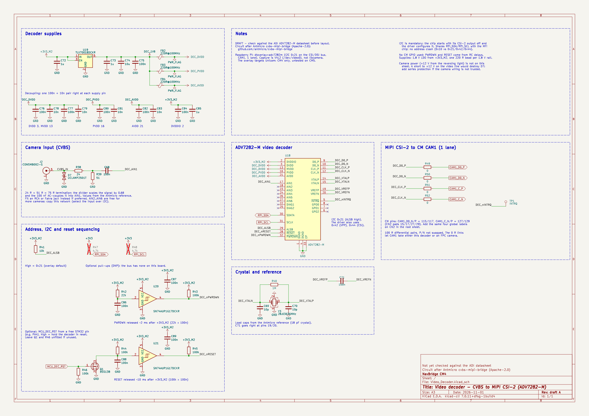

# Video decoder sheet (draft)

Draft KiCad sheet that adds an analog camera input to the NavBridge CM4: a composite (CVBS) reversing camera goes into an **Analog Devices ADV7282-M**, which sends the picture to the Compute Module's **CAM1** port over 1-lane MIPI CSI-2.

> **Status: draft, not yet in the board.** The circuit follows Antmicro's open-source [cvbs-mipi-bridge](https://github.com/antmicro/cvbs-mipi-bridge) board, which uses the same chip. The ADI datasheet could not be downloaded while this was drafted, so check the items in [Before layout](#before-layout) against it first.

<p align="center">
  
</p>

[Video_Decoder.pdf](Video_Decoder.pdf) is a printable copy of the sheet.

## Files

| File | Content |
|---|---|
| `Video_Decoder.kicad_sch` | The sheet (A3) |
| `libs/NavBridge_Video.kicad_sym` | ADV7282-M symbol, SMB jack symbol, power symbols for the new rails |
| `libs/NavBridge_Video.pretty/` | ADV7282-M LFCSP-32 footprint and SLP1006P2T footprint (ESD diode), both from Antmicro |

## Does it need I2C?

Yes. The ADV7282-M has no pin-strapped mode: it starts with its CSI-2 transmitter off, and the Linux driver turns it on and configures it over I2C. It uses the bus that is already on the board, `RPI_SDA` / `RPI_SCL` (CM pins 82 / 80), which it shares with the MFi chip:

| Device | 7-bit address |
|---|---|
| MFi coprocessor | 0x10 |
| ADV7282-M, main map (ALSB high) | 0x21 |
| ADV7282-M, VPP map (set by the driver) | 0x42 |
| ADV7282-M, CSI map (set by the driver) | 0x44 |

No address clash. The Raspberry Pi `adv7282m` overlay expects 0x21 on this bus (the CSI/DSI I2C bus on GPIO 44/45).

No CM GPIO is used. `PWRDWN` and `RESET` are released by RC delays about 2 ms and 10 ms after `+3V3_M2` comes up, the same sequencing as the Antmicro board. The Linux driver treats both lines as optional. An optional N-MOSFET (Q1) lets the STM32 hold the decoder in reset through a free pin.

## Circuit summary

- **Input:** SMB jack (footprint already in `lcsc_footprints`), ESD diode, 24 Ω + 51 Ω termination/divider (75 Ω total), 100 nF AC coupling into AIN1. AIN2 to AIN6 are free for more cameras.
- **Supplies:** DVDDIO from `+3V3_M2` (the M.2 buck, which turns on with the CM). A TLV70018 LDO makes 1.8 V for DVDD/MVDD, PVDD and AVDD, each through its own ferrite bead.
- **Clock:** 28.63636 MHz crystal (Abracon ABM8G, 18 pF), 10 pF load caps, 1 MΩ across.
- **Output:** D0 and CLK pairs through 0 Ω links to global labels `CAM1_D0_P/N`, `CAM1_C_P/N`. The links let CAM1 take either this decoder or an FPC camera.

## Adding it to the project

1. Unzip `NavBridge_CM4_0.1.zip` and copy this folder's `Video_Decoder.kicad_sch` and `libs/` into the project folder.
2. Add the libraries to the project tables (Preferences > Manage Symbol / Footprint Libraries > Project):
   ```
   (lib (name "NavBridge_Video")(type "KiCad")(uri "${KIPRJMOD}/libs/NavBridge_Video.kicad_sym")(options "")(descr ""))
   (lib (name "NavBridge_Video")(type "KiCad")(uri "${KIPRJMOD}/libs/NavBridge_Video.pretty")(options "")(descr ""))
   ```
3. In the root sheet, add a hierarchical sheet and point it at the existing `Video_Decoder.kicad_sch`. The sheet uses global labels and power symbols only, so it needs no sheet pins.
4. In the root sheet, add global labels on CN2: `CAM1_D0_N` (pin 115, CN2 pad 15), `CAM1_D0_P` (117, pad 17), `CAM1_C_N` (127, pad 27), `CAM1_C_P` (129, pad 29).
5. Optional: add a global label `MCU_DEC_RST` on a free STM32 pin (PA4, for example) in the MCU_Lin sheet. Otherwise leave Q1 and R46 unfitted.
6. Run ERC.

The sheet was written in the KiCad 7 file format and KiCad 10 upgrades it when saved. References continue from the current design (U18-U21, C68-C89, R38-R52, D7, FB2-FB4, J2, Q1, Y3, TP1), so nothing should collide. If KiCad shows them as unannotated, run Annotate and keep the existing numbers. The `LCSC` fields are empty: fill them in for JLCPCB assembly.

## Raspberry Pi side

```ini
# config.txt
dtoverlay=adv7282m
```

The overlay uses the legacy Unicam driver, so capture goes through V4L2 (`/dev/video0`) rather than libcamera. The picture is interlaced standard definition (PAL/NTSC). The overlay targets Unicam, which only the CM4 has. The CM5 uses a different camera front end and has not been tried.

## Before layout

Items to confirm in the ADV7282-M datasheet (the drafting environment could not reach analog.com):

- [ ] Pin map. It was taken from the Antmicro symbol, which was checked pin by pin against this sheet.
- [ ] Exposed pad is ground. Footprint pad size: the Antmicro footprint uses 3.76 mm.
- [ ] Supply voltages (DVDDIO 3.3 V, all other rails 1.8 V) and 1.8 V current within the TLV70018's 200 mA.
- [ ] Power-up order and timing for `PWRDWN` and `RESET`.
- [ ] Crystal load capacitors for an 18 pF crystal.
- [ ] Input network values and the ESD diode's working voltage.

Automotive notes:

- The camera's own 12 V supply (usually from the reversing light) is not on this sheet.
- A short to 12 V on the video line would destroy D7. Add series protection if the camera wiring isn't trusted.
- Route the CSI pairs at 100 Ω differential, keep each pair matched, and don't swap P/N.

## Credits and licence

The circuit and the two footprints come from [antmicro/cvbs-mipi-bridge](https://github.com/antmicro/cvbs-mipi-bridge), Copyright (c) 2022-2025 Antmicro, Apache License 2.0 (see `libs/NavBridge_Video.pretty/LICENSE-Apache-2.0` and `NOTICE`). The rest of this folder is under the project's CERN-OHL-S-2.0 licence.
